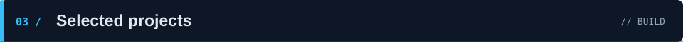

 

  
  

 

- **Studying** Software Engineering at the University of Aveiro, Portugal.
- **Building** academic and personal projects in Java, C and Python.
- **Exploring** operating systems, Linux, databases and software design patterns.
- **Currently working on** system programming and database applications.
- **Always learning** by turning ideas into working software.

 

  

 

 

<table>
  <tr>
    <td width="50%" valign="top">
      <h3><a href="https://github.com/afonsocosta22/tictactoe">Tic-Tac-Toe</a></h3>
      
A simple implementation of the classic game using Pygame.

      
    </td>
    <td width="50%" valign="top">
      <h3>Operating Systems</h3>
      
Academic projects involving Linux, Bash scripting and systems programming in C.

      
      
    </td>
  </tr>
  <tr>
    <td width="50%" valign="top">
      <h3>Object-Oriented Programming</h3>
      
Java exercises and projects focused on design patterns and maintainable software.

      
    </td>
    <td width="50%" valign="top">
      <h3>Prison Management Database</h3>
      
Relational database design and a desktop application using SQL Server and C#.

      
      
    </td>
  </tr>
</table>

Academic repositories may be private. <a href="https://github.com/afonsocosta22?tab=repositories">Browse public repositories →</a>

 

  

  

<picture>
  <source media="(prefers-color-scheme: dark)" srcset="https://raw.githubusercontent.com/afonsocosta22/afonsocosta22/output/github-snake-dark.svg" />
  <source media="(prefers-color-scheme: light)" srcset="https://raw.githubusercontent.com/afonsocosta22/afonsocosta22/output/github-snake.svg" />
  
</picture>

 

